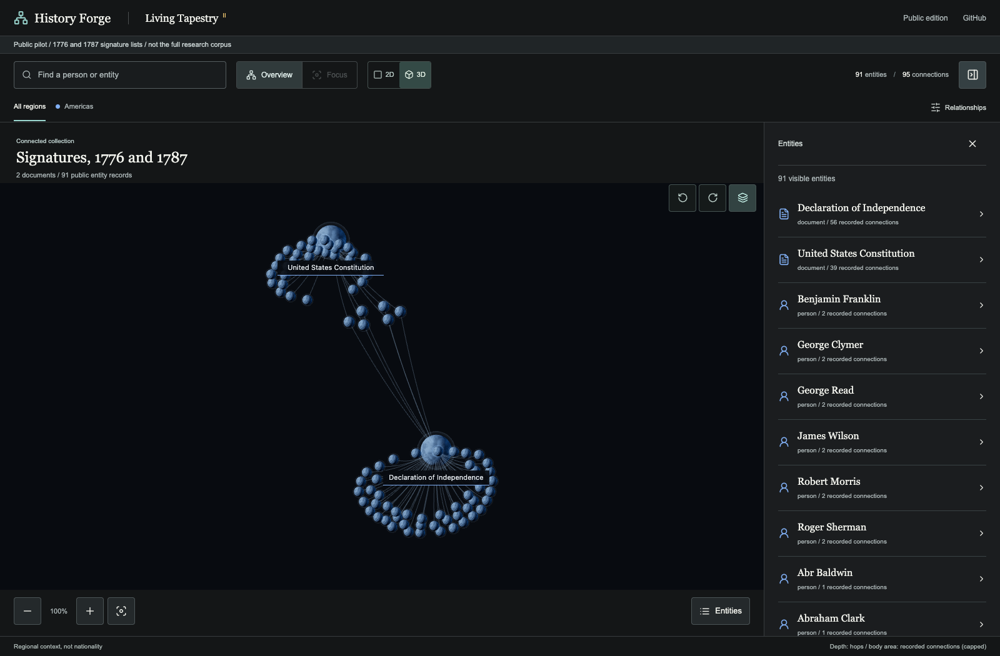
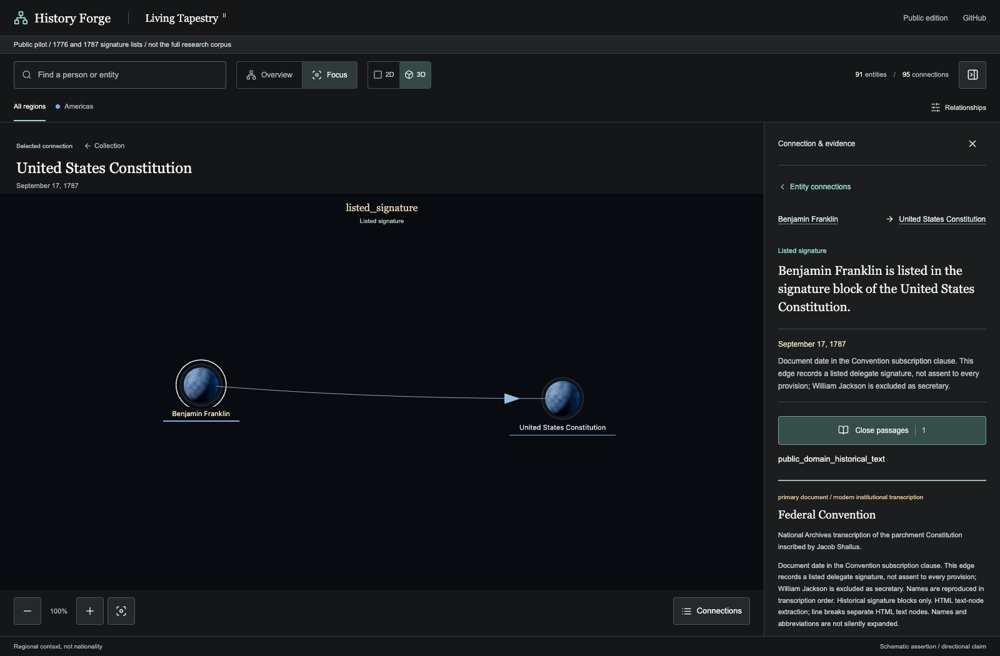
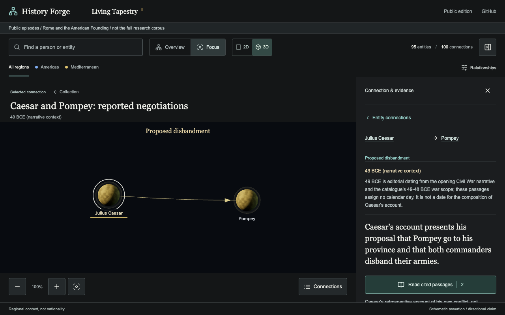

# History Forge

An evidence-bound historical connection explorer, rendered as a living celestial tapestry.

**[Open the public edition](https://titans-forge.github.io/HistoryForge/)**

This release adds a bounded Roman expansion. GitHub Pages updates only after
the build and browser gates pass; see [release review](RELEASE_REVIEW.md).

## The Living Tapestry

Explore the collection as an interactive 3D network, with its entities alongside it:

[](https://titans-forge.github.io/HistoryForge/)

Focus on a connection to see its historical claim, date and source evidence:



These screenshots show the actual public pilot, not the larger private research corpus. Nodes and connecting lines represent recorded source-bound relationships; the spatial arrangement is illustrative.

## Public Expansion Candidate

This release is deliberately smaller than the private History Forge research workspace:

- Five Roman connections from Caesar's account of negotiations in 49 BCE, alongside the unchanged 95 American signature-list connections.
- 95 entity records: 93 person records and two documents, across three source packs. These are records, not a count of independently resolved unique people.
- Four distinct Roman records: Julius Caesar, Pompey, the young Lucius Caesar and Roscius the praetor. No private-registry identities are silently merged.
- An episode browser, with six existing cross-document identity mappings retained for the American lists.
- Celestial 3D overview, accessible 2D alternative, search, focus neighborhoods and a browsable connection list.
- Exact cited excerpts, source and corpus hashes, episode-specific qualifications, and JSON/Markdown evidence exports with source-specific reuse terms.

American edges mean **listed signature**, not friendship, personal contact or co-authorship.
July 4, 1776 is the Declaration's adoption date, not an individual signing date assigned to every signer.
Spatial distance is schematic. Body area reflects recorded connection count within this pilot, not historical importance or confidence.

The two lists are from official National Archives transcriptions. Six identity links use the transcription's own links to NARA biographical entries; these later accounts are not independent primary witnesses. Other source labels and abbreviations are preserved. William Jackson's secretary attestation is not counted among the Constitution's 39 delegate signatures.

Roman edges distinguish **reported messages**, **requests to carry demands**
and **proposed disbandment**. They are attributed to Caesar's partisan,
retrospective account, not proof of an executed peace agreement. The year is
editorial narrative context, not a precise event day or composition date.
The young Lucius Caesar is not Julius Caesar or the envoy's father. Roscius
retains a source-local identity without an inferred cognomen or biography.

The Roman release candidate, rendered locally with its evidence sidebar:



## Run Locally

Requires Node.js 22 and Python 3 (standard library only for deterministic data generation).

```sh
npm ci
npm test
npm run build
npm run preview -- --port 5278
```

Open `http://127.0.0.1:5278/HistoryForge/`. The project intentionally uses the same nested base path as GitHub Pages.
No Python web service, API key, account, model call or database is required. Three.js/WebGL provides optional 3D; the 2D view preserves access when WebGL is unavailable.

## Evidence And Rights

Original code, structured data and annotations: **Apache-2.0**. Historical signature text: separate public-domain status. The old MacDevitt Caesar translation is catalogued as public domain in the USA, not asserted to be cleared worldwide. Its Project Gutenberg notice and full terms accompany displayed and exported excerpts. Dependencies retain their own licenses. See [LICENSE](LICENSE), [NOTICE](NOTICE) and [THIRD_PARTY_NOTICES.md](THIRD_PARTY_NOTICES.md).

`public/data/source-inputs.json` records exact signature blocks, explicit identity mappings, source URLs and capture hashes. `roman-inputs.json` preserves the bounded Roman source pack. `scripts/build_collection.py` regenerates the graph and three corpus payloads without network access. Corpus hashes use canonical JSON excluding `audit`; graph revision excludes `revision`.

The default build fails closed unless `roman-review.json` binds the exact input
bytes and accepted claim set to two distinct independent reviewers. That receipt
is a traceable review record, not a cryptographic authorization service. An
isolated draft can be rendered with `HISTORY_FORGE_REVIEW_CANDIDATE=1`; that
explicit review mode is not a deployment or admission approval.

Full raw HTML captures remain in the private release evidence folder, not in this repository. The public edition contains no modern NARA photographs, document images, biographies, private-use sources, raw research archive, notebooks, credentials, provider tools or research automation. Attribution does not imply National Archives endorsement.

See [RELEASE_REVIEW.md](RELEASE_REVIEW.md) for the exact reviewed release scope and limitations. Independent AI-assisted checks do not replace institutional historical certification or legal advice.

## Deployment

The Pages workflow runs deterministic tests, builds static assets, and runs the production-build browser matrix before deploying. Pull requests validate without deploying. Only `dist/` is deployed. GitHub Pages is configured for GitHub Actions, with no external hosting or paid service required.

Run the browser gate after building:

```sh
npx playwright install chromium
npm run test:browser
```

The matrix covers desktop and phone Chromium at DPR 1 and 2, episode discovery, mode switches,
resize and reload, real graph pixels, evidence exports and return links, and a
simulated WebGL-unavailable fallback. It starts its own nested-path preview on
port 5275 and refuses to reuse another server. Set `HISTORY_FORGE_QA_PORT` for an
unused alternative. Reports, screenshots and failure traces are written outside
the repository under the system temporary directory; `HISTORY_FORGE_QA_DIR`
can select a retained evidence location. Browser emulation does not qualify
physical devices, native Safari or screen-reader usability.

The matrix also forces WebGL context loss and checks selection-preserving 2D
recovery followed by a fresh 3D context. For an already-installed Chromium,
`HISTORY_FORGE_BROWSER` can explicitly select its executable instead of the
Playwright-managed default. Record that browser version with local test results;
passing with a local override does not qualify the CI browser automatically.

Future source packs must pass independent textual and rights/identity review, including actual app and export checks, before admission. The private working corpus is not a publication queue and must not be copied wholesale into this project.
